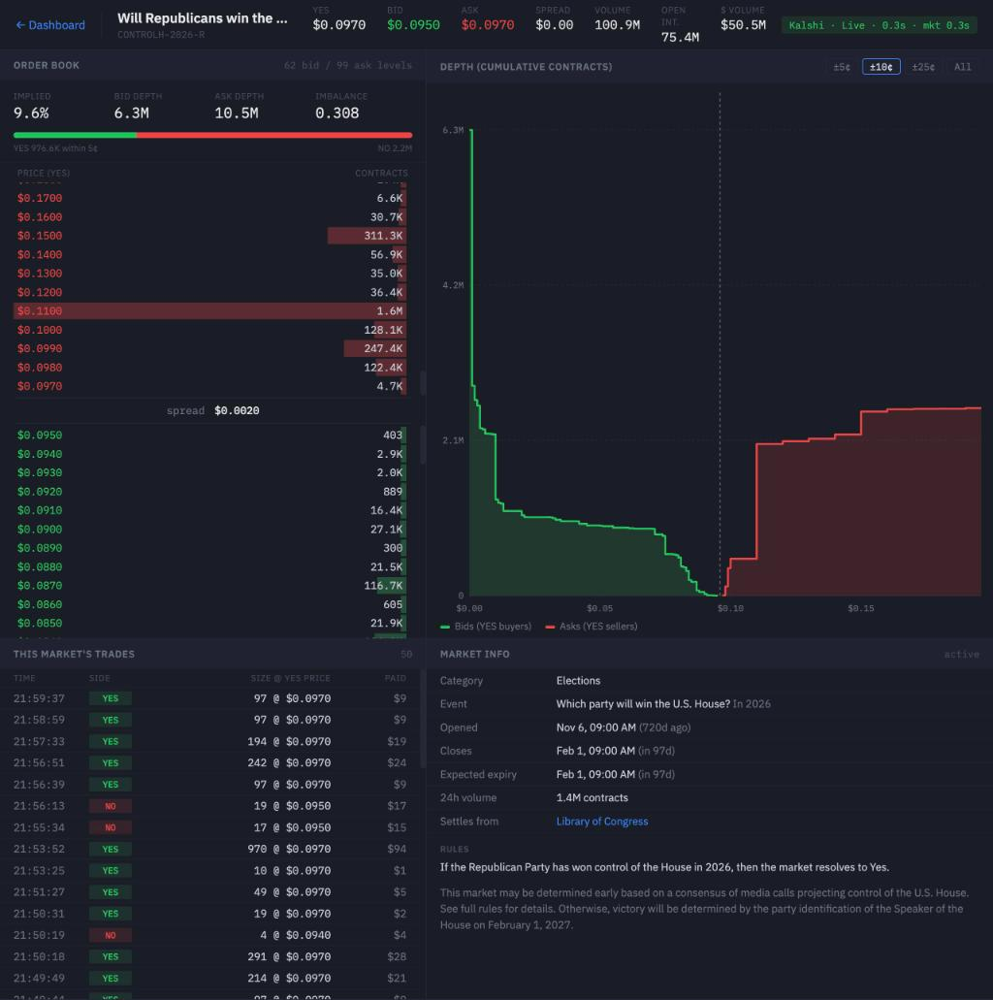
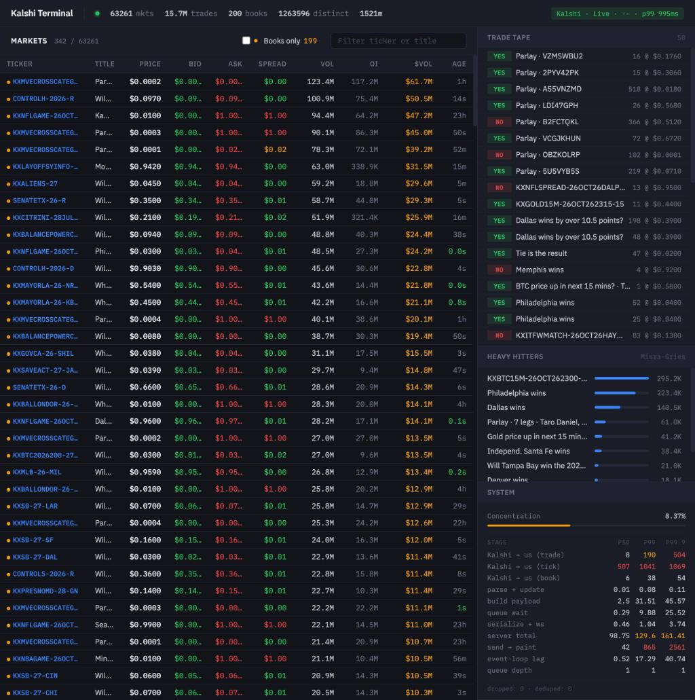

# Kalshi Order Book Dashboard

A self-hosted, real-time dashboard for [Kalshi](https://kalshi.com) prediction markets. Streams order books, trades and prices from Kalshi's WebSocket API and serves them to your browser.



## Overview

This project gives you a live view of Kalshi from a server you run yourself:
- A home table of the highest-volume markets
- Full order books for as many markets as you configure (we run 200)
- A page per market with the order book, a depth chart, its trades and Kalshi's market details
- Latency figures for each step from Kalshi to the browser

Currently supported features:
- Ticker, trade and order book channels from Kalshi's WebSocket API
- Order book selection by recent dollar volume, re-checked every 10 seconds
- Sequence-gap detection with automatic snapshot resync
- Optional trade storage in [DuckDB](https://duckdb.org)
- Password protection through Caddy when deployed



## Installation & Usage

Requires Python 3.10+ and a Kalshi account with an API key. Create the key in your Kalshi account settings; you get a key ID and a private key file.

```bash
git clone https://github.com/SouparneyaC/kalshi-orderbook-dashboard.git
cd kalshi-orderbook-dashboard
python3 -m venv venv
venv/bin/pip install -r requirements.txt
```

Copy `.env.example` to `.env` and set your key ID and the path to your private key:

```bash
cp .env.example .env
```

Start the server:

```bash
set -a; source .env; set +a
venv/bin/uvicorn app.server.main:app --host 127.0.0.1 --port 8000
```

Then open http://localhost:8000. Order books start filling within a minute or two, once there is enough trading to rank markets.

### Configuration

All settings are environment variables.

| Variable | Default | Meaning |
|---|---|---|
| `KALSHI_KEY_ID` | required | Your Kalshi API key ID |
| `KALSHI_PRIVATE_KEY_PATH` | required | Path to the private key (RSA or Ed25519 PEM) |
| `BOOK_COUNT` | `25` | Number of markets to hold full order books for |
| `TOP_LIST_BOOKS` | `BOOK_COUNT / 4` | How many of those go to the top rows of the home table |
| `PERSIST_TRADES` | `1` | Set to `0` to stop saving trades to `trades.duckdb` |

### Endpoints

| Path | What it is |
|---|---|
| `/` | Home dashboard |
| `/market/{ticker}` | Market page (404 if the market has no order book) |
| `/api/market/{ticker}/info` | Kalshi market details as JSON, cached for 60 s |
| `/latency` | Latency percentiles per pipeline stage |
| `/debug/mem` | Memory, garbage collector and queue counters |

### Tests

```bash
venv/bin/python -m unittest discover -s tests -t .
```

The tests replay a simulated Kalshi stream (`tests/sim_stream.py`), so they need no network or API key. `tests/test_golden.py` checks that refactors leave the dashboard payloads and database rows unchanged.

## Running on a server

`deploy/` has what we use in production: a setup script for a fresh Ubuntu 24.04 machine (`setup-server.sh`), a systemd unit that restarts the app if it exits (`tradedash.service`) and a [Caddy](https://caddyserver.com) config that puts a password in front of the dashboard (`Caddyfile`). The app itself only listens on 127.0.0.1.

Our instance is an AWS EC2 t4g.small (2 ARM vCPUs, 2 GiB of memory) in us-east-2 (Ohio), the same AWS region as Kalshi's API. Measured on it with 200 order books:

| | Measured |
|---|---|
| Kalshi to server, trades | 7 ms median, 30 to 50 ms p99 |
| Kalshi to server, order book updates | 7 ms median, about 20 ms p99 |
| Home page update interval | 100 ms |
| Market page update interval | about 50 ms |
| CPU | 27 to 47% of one core, depending on how many tabs are open |
| Memory | 150 to 200 MB |

Each extra order book cost about 0.026% of one core when we stepped from 25 to 400 books on the live server; memory and latency did not change over that range.

A t4g instance earns CPU credits and is slowed to a baseline of about 20% per vCPU once they run out. This workload ran out of credits on busy evenings. If you see high "steal" time in `top`, either enable unlimited credits or move to a non-burstable instance.

## Project Structure

```
├── app/
│   ├── server/
│   │   ├── main.py            # FastAPI app: routes, browser WebSockets, startup
│   │   ├── broadcast.py       # Home page updates, one sender per browser tab
│   │   └── market_page.py     # Market page updates and Kalshi market details
│   ├── kalshi/
│   │   ├── kalshi_feed.py     # Kalshi WebSocket client, message handling, order book selection
│   │   ├── book_seq.py        # Detects skipped sequence numbers and requests fresh snapshots
│   │   └── auth.py            # Kalshi request signing
│   ├── core/
│   │   ├── market_state.py    # In-memory market data and the payloads sent to browsers
│   │   ├── orderbook.py       # Order book for one market (integer prices and sizes)
│   │   ├── streaming.py       # Streaming sketches (heavy hitters, concentration, distinct count)
│   │   └── latency.py         # Latency percentiles and garbage collector timing
│   ├── storage/
│   │   └── persistence.py     # DuckDB trade storage (writes trades.duckdb in the repo root)
│   └── dashboard/
│       ├── dashboard.html     # Home page
│       └── market.html        # Market page
├── deploy/                    # Server setup script, systemd unit, Caddy config
├── docs/                      # Screenshots
└── tests/                     # Unit tests and the simulated Kalshi stream
```

## Notes

- The server is a single Python process: FastAPI on one asyncio event loop. It subscribes to Kalshi's ticker, trade and lifecycle channels for every open market and to order book depth for the selected markets, and sends each browser tab only what changed.
- A quarter of the order book slots go to the top rows of the home table. The rest go to the markets with the most dollars traded in the last few minutes.
- Order book messages from Kalshi carry a sequence number per subscription. A gap means a message was lost, and since Kalshi sends book changes as increments, the server re-requests snapshots of every book on that subscription.
- Saving trades is the most CPU-hungry part on a small instance. On the t4g.small the database writer fell behind during busy hours, so our deployment runs with `PERSIST_TRADES=0`.
- Comments citing sections like "Drepper §6.2.1" refer to Ulrich Drepper, [What Every Programmer Should Know About Memory](https://www.akkadia.org/drepper/cpumemory.pdf) (2007), which guided the memory layout of the hot paths.
- This project is not affiliated with Kalshi. Use of Kalshi's API is subject to Kalshi's terms.

## License

[MIT](LICENSE)
