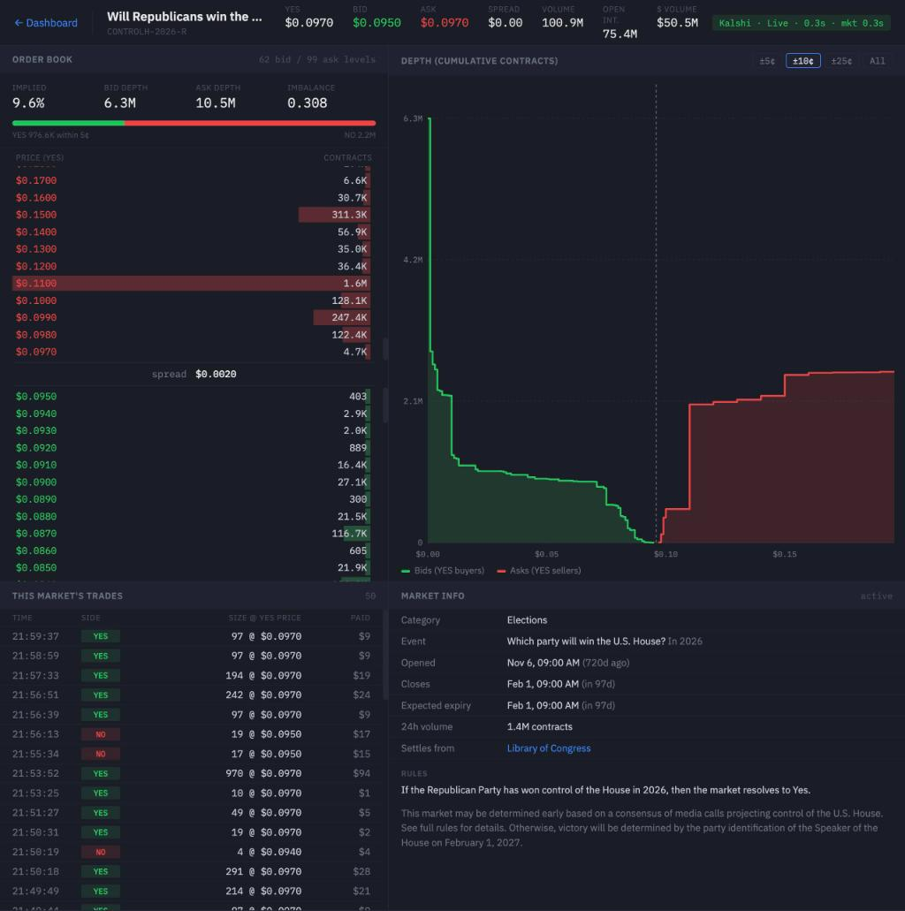
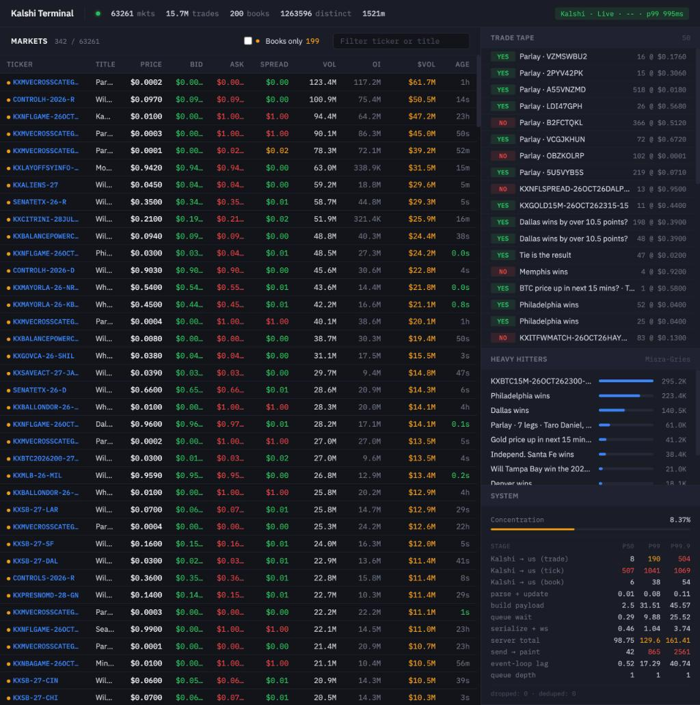
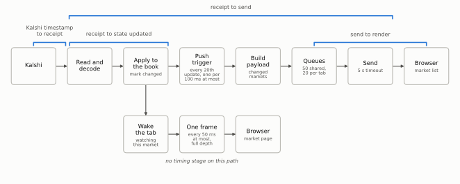
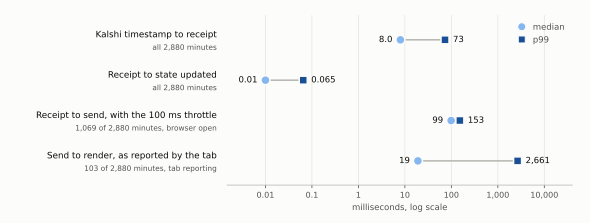
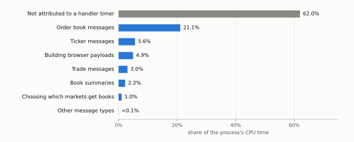
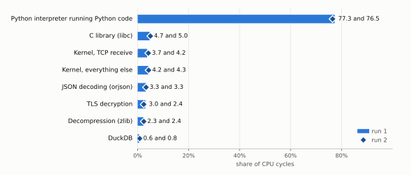
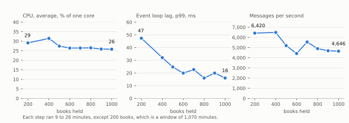

# Kalshi Order Book Dashboard

A live order book service for [Kalshi](https://kalshi.com) prediction markets. Streams order books, trades and prices from Kalshi's WebSocket API into memory and serves them to your browser.

[](https://github.com/SouparneyaC/kalshi-orderbook-dashboard/actions/workflows/ci.yml)
[](LICENSE)




## Overview

The project is the pipeline from Kalshi to the browser, and how fast it is. The dashboard is the display at the end.

- One Python process on one small server
- Order books held in memory
- Lost updates repaired from snapshots
- Timed stages from Kalshi to the browser

Currently supported features:
- Ticker, trade and order book channels
- Order book selection by dollar volume
- Sequence-gap detection with automatic snapshot resync
- Accuracy audit against Kalshi snapshots
- Per-minute latency and load history
- Optional trade storage in [DuckDB](https://duckdb.org)
- Password protection through Caddy when deployed



## How fast it is

<picture>
  <source media="(prefers-color-scheme: dark)" srcset="docs/img/path-dark.svg">
  
</picture>

The bracketed stages in the picture are timed, and every sample goes into a histogram. The figures below are from an AWS EC2 t4g.small (2 vCPUs, 2 GiB of memory) in us-east-2, the same AWS region as Kalshi's API, over 48 hours from 2026-11-04 with 200 order books.

<picture>
  <source media="(prefers-color-scheme: dark)" srcset="docs/img/latency-hops-dark.svg">
  
</picture>

A book is updated a median 0.01 ms after the process receives a message. The message arrives a median 8.0 ms after Kalshi's timestamp. The two browser rows have samples only while a tab was open (1,069 and 103 of the 2,880 minutes), and the timers stop at the server's send. What each stage cannot show is in [docs/benchmarks.md](docs/benchmarks.md).

## Installation & Usage

Tested on Python 3.12. Needs a Kalshi account with an API key. Create the key in your Kalshi account settings; you get a key ID and a private key file.

```bash
git clone https://github.com/SouparneyaC/kalshi-orderbook-dashboard.git
cd kalshi-orderbook-dashboard
python3 -m venv venv
venv/bin/pip install -r requirements-lock.txt
```

`requirements-lock.txt` has the exact versions the tests passed with. `requirements.txt` is the looser list.

Copy `.env.example` to `.env` and set your key ID and the path to your private key:

```bash
cp .env.example .env
```

Start the server:

```bash
set -a; source .env; set +a
venv/bin/uvicorn app.server.main:app --host 127.0.0.1 --port 8000
```

Then open http://localhost:8000. Order books start filling within a minute or two, once there is enough trading to rank markets.

The other settings and the endpoints are in [docs/configuration.md](docs/configuration.md).

### With Docker

```bash
cp .env.example .env     # set KALSHI_KEY_ID, and uncomment KALSHI_PRIVATE_KEY_FILE
mkdir -p data
HOST_UID=$(id -u) HOST_GID=$(id -g) docker compose up --build
```

The container runs the same code with trade storage off and writes the measurement history to `./data`. The port is published on 127.0.0.1 only. This is a way to try the service. Our measured deployment runs under systemd, as described below.

### Tests

```bash
venv/bin/python -m unittest discover -s tests -t .
```

The tests replay a simulated Kalshi stream (`tests/sim_stream.py`), so they need no network or API key. `tests/test_golden.py` checks that refactors leave the dashboard payloads and database rows unchanged.

## Running on a server

`deploy/` has what we use in production: a setup script for a fresh Ubuntu 24.04 machine (`setup-server.sh`), a systemd unit that restarts the app if it exits (`tradedash.service`) and a [Caddy](https://caddyserver.com) config that puts a password in front of the dashboard (`Caddyfile`). The app itself only listens on 127.0.0.1. [docs/deployment.md](docs/deployment.md) goes through each step.

Our instance is an AWS EC2 t4g.small (2 ARM vCPUs, 2 GiB of memory) in us-east-2 (Ohio), the same AWS region as Kalshi's API. Measured on it over 48 hours (2026-11-04 to 2026-11-06) with 200 order books, trade storage off and no restart. A browser tab was open in 34.5% of the minutes:

| | Measured |
|---|---|
| Kalshi's timestamp to receipt, trades | 8.0 ms median, 70 ms p99 |
| Kalshi's timestamp to receipt, order book updates | 8.0 ms median, 73 ms p99 |
| Home page update interval | 100 ms |
| Market page update interval | about 50 ms |
| CPU | 33.0% of one core on average, 65.0% in the busiest minute |
| Memory | 318.9 MB on average, 369.8 MB at most |
| Hypervisor steal | 0.64% of CPU time on average, 2.5% at most |

A t4g instance earns CPU credits and is slowed to a baseline of about 20% per vCPU once they run out. On 2026-10-21, with trade storage on, ours ran out and showed 36 to 50% steal time; in the 48 hours above, with storage off, steal averaged 0.64%. We could not read the credit balance itself. If you see high "steal" time in `top`, either enable unlimited credits or move to a non-burstable instance.

## Performance

<picture>
  <source media="(prefers-color-scheme: dark)" srcset="docs/img/cpu-by-handler-dark.svg">
  
</picture>

The handler timers cover 38.0% of the process's CPU time. No timer covers the rest. A profile of the live process with perf and py-spy, taken on the evening of 2026-11-16 at 400 books, puts 77% of CPU cycles in the Python interpreter running Python code. TLS decryption, decompression, JSON decoding and the kernel's TCP receive path take between 2.3% and 4.2% each.

<picture>
  <source media="(prefers-color-scheme: dark)" srcset="docs/img/perf-split-dark.svg">
  
</picture>

The books were also stepped from 200 to 1,000 on the live server overnight, with no browser open. CPU stayed between 25% and 32% of one core and there were no sequence gaps. The message rate fell during the night, so the plot cannot show the cost of one book.

<picture>
  <source media="(prefers-color-scheme: dark)" srcset="docs/img/capacity-dark.svg">
  
</picture>

The conditions, the tables behind each plot and the limits are in [docs/benchmarks.md](docs/benchmarks.md). The plots are drawn from the files in `numbers/` by `bench/plots/make_plots.py`.

## Project Structure

```
├── app/
│   ├── server/
│   │   ├── main.py            # FastAPI app: routes, browser WebSockets, startup
│   │   ├── broadcast.py       # Home page updates, one sender per browser tab
│   │   └── market_page.py     # Market page updates and Kalshi market details
│   ├── kalshi/
│   │   ├── kalshi_feed.py     # Kalshi WebSocket client, message handling, order book selection
│   │   ├── book_seq.py        # Detects skipped sequence numbers and requests fresh snapshots
│   │   ├── book_audit.py      # Compares held books with snapshots from Kalshi
│   │   └── auth.py            # Kalshi request signing
│   ├── core/
│   │   ├── market_state.py    # In-memory market data and the payloads sent to browsers
│   │   ├── orderbook.py       # Order book for one market (integer prices and sizes)
│   │   ├── streaming.py       # Streaming sketches (heavy hitters, concentration, distinct count)
│   │   └── latency.py         # Latency percentiles and garbage collector timing
│   ├── storage/
│   │   ├── persistence.py     # DuckDB trade storage (writes trades.duckdb in the repo root)
│   │   └── metrics_store.py   # Per-minute latency histograms and counters (writes metrics.duckdb)
│   └── dashboard/
│       ├── dashboard.html     # Home page
│       ├── market.html        # Market page
│       └── graph.html         # Pipeline and load page
├── bench/plots/               # Draws the plots and tables from numbers/
├── deploy/                    # Server setup script, systemd unit, Caddy config
├── docs/                      # Architecture, configuration, deployment, benchmarks, plots
├── numbers/                   # The numbers behind the measurements, with a source and a check for each
└── tests/                     # Unit tests and the simulated Kalshi stream
```

## Notes

- The server is a single Python process: FastAPI on one asyncio event loop. It subscribes to Kalshi's ticker, trade and lifecycle channels for every open market and to order book depth for the selected markets, and sends each browser tab only what changed. [docs/architecture.md](docs/architecture.md) follows one message through it.
- A quarter of the order book slots go to the top rows of the home table. The rest go to the markets with the most dollars traded in the last few minutes.
- Order book messages from Kalshi carry a sequence number per subscription. A gap means a message was lost, and since Kalshi sends book changes as increments, the server re-requests snapshots of every book on that subscription.
- The audit asks Kalshi for a fresh snapshot of one book and compares it with ours. Asking for a snapshot makes Kalshi skip a few updates that share the snapshot's clock value, so a difference can come from the check itself. Not every request gets a reply.
- Saving trades is the most CPU-hungry part on a small instance. On the t4g.small the database writer fell behind during busy hours, so our deployment runs with `PERSIST_TRADES=0`.
- The service places no orders. It reads the feed, order book snapshots and market details.
- Comments citing sections like "Drepper §6.2.1" refer to Ulrich Drepper, [What Every Programmer Should Know About Memory](https://www.akkadia.org/drepper/cpumemory.pdf) (2007), which guided the memory layout of the hot paths.
- The figures above are rows of the files in `numbers/`, each with its window, source and a check status (`numbers/README.md`). The per-book CPU cost of about 0.026% of one core, from stepping 25 to 400 books on the live server, is from an earlier run that is not in those files.
- This project is not affiliated with Kalshi. Use of Kalshi's API is subject to Kalshi's terms.

## Contributing

Bug reports, documentation fixes and small pull requests are welcome. [CONTRIBUTING.md](CONTRIBUTING.md) has the setup, the checks and what is out of scope. Report a vulnerability through the process in [SECURITY.md](SECURITY.md). The [CHANGELOG](CHANGELOG.md) lists what changed in each release.

## Credits

Built by Souparneya Chakrabarti, with Claude, an AI model from Anthropic, as a coding collaborator. To cite the software, use the "Cite this repository" box on the repository page, which reads `CITATION.cff`.

## License

[MIT](LICENSE)
