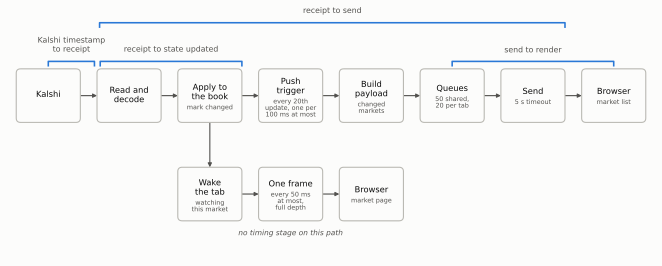

# Architecture

The service moves Kalshi's order book messages to a browser and times every step on the way. The dashboard is the display at the end of the pipeline. The design is in the pipeline: one process, books in memory, and a way to notice and repair a lost update.

<picture>
  <source media="(prefers-color-scheme: dark)" srcset="img/path-dark.svg">
  
</picture>

## One process, one event loop

The server is one Python process: FastAPI on uvicorn, on one asyncio event loop. The loop reads the Kalshi WebSocket, updates the books, builds the payloads and sends them to browsers. There is no queue between processes and no database in the path of a message. One long task delays everything else on the loop, so the code keeps each handler short and times the loop itself (`loop_lag` in the history).

A second thread writes the per-minute measurement history to DuckDB, so that slow disk work never runs on the loop.

## Reading the feed

`app/kalshi/kalshi_feed.py` opens one WebSocket to Kalshi, signs the request (`auth.py`) and subscribes to the ticker, trade and lifecycle channels for every open market, and to order book depth for the markets it holds books for. Each message gets a receipt stamp when the WebSocket library hands it to our code. By then the library has already decrypted, parsed and decompressed it. JSON decoding comes after the stamp.

A quarter of the book slots go to the top rows of the home table. The rest go to the markets with the most dollars traded in the last few minutes, re-checked every 10 seconds.

## The book

`app/core/orderbook.py` holds one book per market. Prices are integers in ticks of $0.0001 and quantities are integers in hundredths of a contract, so arithmetic is exact. Each side is two plain Python lists in step, prices in ascending order, so the best bid is the last element and needs no search. An update finds its level with a binary search (`bisect_left`). Kalshi sends bids for YES and bids for NO and no asks, so the ask side is derived.

## Keeping books correct

Kalshi numbers the order book messages of each subscription in order.

- `book_seq.py` compares each number with the one before it. A jump means a message was lost, and since changes arrive as increments, the books on that subscription are wrong until they are replaced. The service asks for a fresh snapshot of each, and does not ask again for a market whose snapshot is already on its way.
- `book_audit.py` asks Kalshi for a snapshot of one book every few seconds and compares every level with ours before loading it. Asking for a snapshot makes Kalshi skip a few updates that share the snapshot's clock value, so a difference can come from the check itself. Not every request gets a reply. The audit tells us the check ran and what it found. It does not give an accuracy rate.

## Getting changes to browsers

- A push is triggered on every 20th order book update and at most once per 100 ms. A call inside the window schedules one flush for the end of it.
- The payload holds only the markets that changed. It goes on a shared queue of 50 slots. If the queue is full the push is dropped, so ingestion never waits on a browser.
- Each open tab has its own queue of 20 slots and its own sender. A tab that falls behind is resynced with a full snapshot and the other tabs are not held up. A send that takes more than 5 seconds closes that tab.
- A market page gets a frame at most every 50 ms, with the full depth, and frames are never queued.

## Measuring itself

`app/core/latency.py` and `app/storage/metrics_store.py` time every stage in the picture and record every sample in a histogram with logarithmic buckets, 16 to each doubling of the value. A value read back from a bucket is within about 2.2% of the sample. Once a minute the histograms and counters are written to `metrics.duckdb`, labelled with the run and the commit. `/latency` and `/graph` show the same stages live.

The measurements behind this repository, and what each one cannot show, are in [benchmarks.md](benchmarks.md).

## What it does not do

- It places no orders. It reads the feed, order book snapshots and market details.
- It has no login. Put a password in front of it (see [deployment.md](deployment.md)).
- It gives no accuracy rate for the books, because the audit changes what it measures.
- It is one process on one machine. There is no failover.
