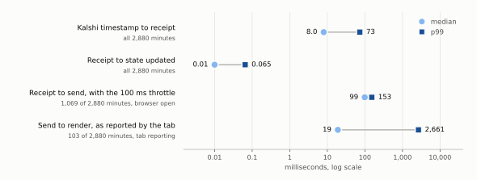
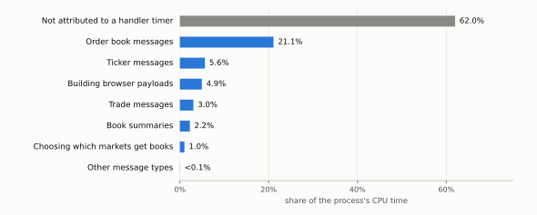
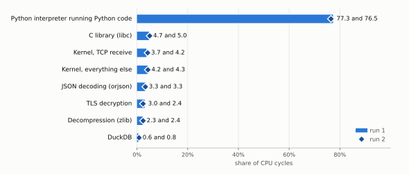
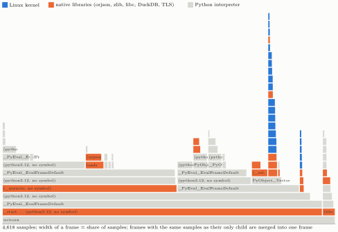
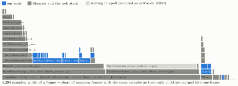
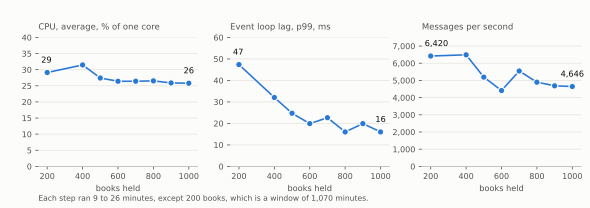

# Benchmarks

What the service was measured at, on which machine, over which window, and what each plot cannot show. Every figure here was measured on the server. Every value is a row in [`numbers/`](../numbers/README.md) with its window, source and check status, and the plots and tables on this page are drawn from those rows by [`bench/plots/make_plots.py`](../bench/plots/make_plots.py).

## Conditions

| | |
|---|---|
| Machine | AWS EC2 t4g.small: 2 Arm vCPUs, 2 GiB of memory |
| Region | us-east-2 (Ohio), the same AWS region as Kalshi's API host |
| Operating system | Ubuntu 24.04 |
| Python | 3.12 |
| Library versions | Not recorded in `numbers/`. `requirements-lock.txt` lists the versions the tests ran with on 2026-11-21 |
| Code | `app/` of this repository, built from commit 48fc24a of the author's working repository, the code the 48-hour capture ran |
| 48-hour capture | From 2026-11-04 16:11 UTC, 200 books, trade storage off, audit every 5 seconds, no restart. A browser tab was open in 994 of the 2,880 minutes, with 1.65 tabs on average and 10 at most |
| Capacity test | 2026-11-13 to 2026-11-14, 200 to 1,000 books, overnight, no browser open |
| Profile | Evening of 2026-11-16 (01:55 to 02:15 UTC on 11-17), 400 books, no browser open, 7 windows of 120 seconds, 8,399 to 11,500 messages per second |

## Latency, stage by stage

<picture>
  <source media="(prefers-color-scheme: dark)" srcset="img/latency-hops-dark.svg">
  
</picture>

The 48-hour capture. The dot is the median, the square is the p99. The plot gives the minutes behind each row, because the two browser rows have samples only while a tab was open.

<!-- table:latency -->
| Stage | Median (ms) | p99 (ms) | p99.9 (ms) | Minutes with samples | Rows |
|---|---|---|---|---|---|
| Kalshi timestamp to receipt, order book updates | 8.0 | 73 | 235 | 2,880 of 2,880 | `lat.venue_to_recv.book.*` |
| Kalshi timestamp to receipt, trades | 8.0 | 70 | 431 | 2,880 of 2,880 | `lat.venue_to_recv.trade.*` |
| Receipt to state updated | 0.01 | 0.065 | 0.115 | 2,880 of 2,880 | `lat.recv_to_hub.*` |
| Build the payload | 3.2 | 35 | 64 | 1,074 of 2,880 | `lat.build.*` |
| Wait in the shared queue | 0.386 | 21 | 56 | 1,074 of 2,880 | `lat.queue_wait.*` |
| Encode and hand to each tab | 0.571 | 1.3 | 2.5 | 1,074 of 2,880 | `lat.serialize_send.*` |
| Receipt to send, with the 100 ms throttle | 99 | 153 | 257 | 1,069 of 2,880 | `lat.recv_to_send.*` |
| Send to render, as reported by the tab | 19 | 2,661 | 7,528 | 103 of 2,880 | `lat.send_to_render.*` |
<!-- /table:latency -->

What the stages cannot show:

- Kalshi timestamp to receipt compares Kalshi's clock with the server's. It is only as good as the two clocks, and we cannot check Kalshi's.
- The receipt stamp is taken when the WebSocket library hands a message to our code, after the library has decrypted, parsed and decompressed it and before JSON decoding. Time spent before that point is in the first row and nowhere else.
- Receipt to send includes the wait of up to 100 ms that batches pushes, so its median is mostly that wait. It is stamped from the message that triggered the push, so it understates the age of the other changes in the same push.
- Send to render needs a tab that reports back, and that happened in 103 of the 2,880 minutes. It compares the server's clock with the tab's.
- None of this is the time from an event at Kalshi to a trader's screen. The timers stop at the server's send, apart from those 103 minutes.

## CPU by handler

<picture>
  <source media="(prefers-color-scheme: dark)" srcset="img/cpu-by-handler-dark.svg">
  
</picture>

The handler timers cover 38.0% of the process's CPU time over the 48 hours. The grey bar is the rest: no handler timer covers it. The profile below breaks the whole process down.

<!-- table:cpu -->
| Work | Share of the handler timers | Share of the process's CPU time | Row |
|---|---|---|---|
| Order book messages | 55.5% | 21.1% | `cpu.handler.orderbook_delta.share` |
| Ticker messages | 14.8% | 5.6% | `cpu.handler.ticker.share` |
| Building browser payloads | 13.0% | 4.9% | `cpu.handler.payload_build.share` |
| Trade messages | 8.0% | 3.0% | `cpu.handler.trade.share` |
| Book summaries | 5.9% | 2.2% | `cpu.handler.book_summary.share` |
| Choosing which markets get books | 2.7% | 1.0% | `cpu.handler.promotion_check.share` |
| Not attributed to a handler timer | | 62.0% | 100 minus `cpu.named_handlers_share_of_process` |
<!-- /table:cpu -->

## Profile

Two perf runs and several py-spy runs on the live process, with the figures from the two perf runs below. perf sampled CPU cycles at 99 Hz and cannot see names inside the Python interpreter. py-spy can see Python function names. The two runs of each tool agree to within a point or two.

<picture>
  <source media="(prefers-color-scheme: dark)" srcset="img/perf-split-dark.svg">
  
</picture>

<!-- table:perf -->
| Where the cycles went | Run 1 | Run 2 | Rows (`profile.perf.*`) |
|---|---|---|---|
| Python interpreter running Python code | 77.3% | 76.5% | `interp_share` |
| C library (libc) | 4.7% | 5.0% | `libc_share` |
| Kernel, TCP receive | 3.7% | 4.2% | `kernel_net_share` |
| Kernel, everything else | 4.2% | 4.3% | `kernel_share minus kernel_net_share` |
| JSON decoding (orjson) | 3.3% | 3.3% | `orjson_share` |
| TLS decryption | 3.0% | 2.4% | `tls_share` |
| Decompression (zlib) | 2.3% | 2.4% | `zlib_share` |
| DuckDB | 0.6% | 0.8% | `duckdb_share` |
<!-- /table:perf -->

The shares do not add to 100%. The rest is small items not shown.

The flame graphs below are from the profile. The width of a frame is its share of the samples, and a frame with the same samples as its only child is merged into it. They are drawn on a light background in both themes.





What the profile cannot show:

- The profilers cost CPU. Per message the process used 42.1 µs with no profiler, 43.0 µs under py-spy and 45.5 µs under perf, which is 8.1% more under perf (`profile.overhead.*`).
- The py-spy runs collected fewer samples than they were asked for, and we do not know why. On Linux ARM py-spy also cannot tell an idle thread from a busy one, so the flame graph counts time waiting in epoll as active.
- It is one evening, with no browser open.
- The raw stacks behind the flame graphs are in the author's working repository and not here, so these two images cannot be redrawn from this repository.

## Capacity

<picture>
  <source media="(prefers-color-scheme: dark)" srcset="img/capacity-dark.svg">
  
</picture>

The books were stepped up on the live server overnight, with no browser open. Each step after 200 books ran 9 to 26 minutes. The 200-book row is the long window of 1,070 minutes. No step had a sequence gap.

<!-- table:capacity -->
| Books held | Minutes judged | CPU, average (% of one core) | CPU, p95 | Event loop lag p99 (ms) | Messages per second | Steal, average | Sequence gaps |
|---|---|---|---|---|---|---|---|
| 200 | 1,070 | 29.1 | 35.0 | 47.4 | 6,420 | 0.73% | 0 |
| 400 | 11 | 31.5 | 33.2 | 32.1 | 6,489 | 0.70% | 0 |
| 500 | 25 | 27.4 | 28.7 | 24.7 | 5,192 | 0.71% | 0 |
| 600 | 10 | 26.4 | 28.8 | 19.9 | 4,412 | 0.96% | 0 |
| 700 | 9 | 26.4 | 27.7 | 22.7 | 5,548 | 0.67% | 0 |
| 800 | 9 | 26.5 | 27.9 | 16.0 | 4,897 | 0.77% | 0 |
| 900 | 26 | 25.9 | 27.8 | 19.9 | 4,686 | 0.72% | 0 |
| 1,000 | 23 | 25.8 | 27.3 | 16.0 | 4,646 | 0.69% | 0 |
<!-- /table:capacity -->

Read this test with care. The message rate fell from 6,420 to 4,646 per second as the night went on, and the steps ran at different times, so CPU and lag falling here does not mean a book costs nothing. An earlier live run that stepped from 25 to 400 books gave about 0.026% of one core per extra book. That run is not in `numbers/`. This test did not cover the evening peak or an open browser tab.

## The 48-hour capture

<!-- table:health -->
| Over the 48 hours | Value | Row |
|---|---|---|
| Messages received | 1,010,892,111 | `msgs.total` |
| Messages per second, average | 5,852 | `msgs.per_s_avg` |
| Messages per second, busiest minute | 11,300 | `msgs.per_s_peak_minute` |
| Books held, average | 200 | `books.avg` |
| CPU, average (% of one core) | 33.0 | `cpu.avg` |
| Memory, average (MB) | 318.9 | `rss.avg` |
| Memory, highest minute (MB) | 369.8 | `rss.max` |
| Steal, average (% of CPU time) | 0.64 | `steal.avg` |
| Steal, highest minute (% of CPU time) | 2.5 | `steal.max` |
| Sequence gaps in order book messages | 0 | `seq.gaps` |
| Restarts | 0 | `window.restarts` |
<!-- /table:health -->

## What is not measured

- An accuracy rate for the books. The audit asks Kalshi for a snapshot, and asking changes which updates Kalshi sends, so a mismatch can come from the check itself.
- The time from an event at Kalshi to a trader's screen.
- Load beyond what was run: 200 books over 48 hours, up to 1,000 books overnight, and 400 books in the evening profile.
- Any other machine. Rows measured on the author's laptop exist in `numbers/` and carry `LAPTOP` in their note column. They are not used on this page.

## Reproduce

The plots and the tables on this page need no server, key or network:

```bash
python3.12 -m venv venv
venv/bin/pip install -r requirements-bench.txt
venv/bin/python bench/plots/make_plots.py
```

This rewrites `docs/img/*.svg` and the tables above from `numbers/`. To change a figure, change its row and run the script again.

The capture, the capacity test and the profile cannot be rerun from this repository. They need a Kalshi key, a server like ours and the scripts that are in the author's working repository. The `source` column of each row says which table or tool it came from.
